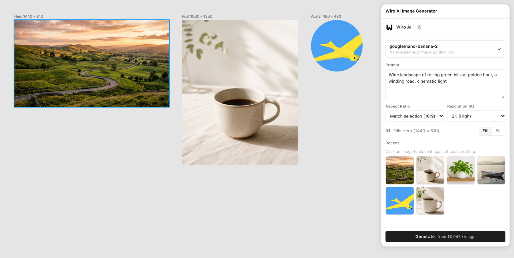

<div align="center">


# Wiro AI Image Generator for Figma

Generate images from a prompt with Wiro AI image models such as Nano Banana Pro, GPT Image 2, Seedream 4.5 and FLUX.2 Pro, and place them as image fills in your selected layers.

[](#install) [](https://github.com/wiroai/Wiro-Figma/actions/workflows/ci.yml) [](./LICENSE)

[Website](https://wiro.ai) · [Models](https://wiro.ai/models) · [Docs](https://wiro.ai/docs) · [Dashboard](https://wiro.ai/panel)


</div>

Select a frame, write a prompt and pick a model. The plugin sends the run to the [Wiro AI API](https://wiro.ai/docs/run-a-model), waits for it and puts the result into the frame as an image fill. With nothing selected, the image lands in a new rectangle in the middle of your view. The aspect ratio follows the shape of the selected layer, so a 1920 × 1080 frame gets a 16:9 image and a 1080 × 1350 post gets 4:5 or the nearest ratio the model offers.



| Choose a model                                                                   | Light and dark                                                       | Connect with a key                                                                     |
| -------------------------------------------------------------------------------- | -------------------------------------------------------------------- | -------------------------------------------------------------------------------------- |
|  |  |  |

## What it does

- **Fills what you select.** Frames, shapes, text, components and instances take the image as a fill. Select several layers and each one gets an image: when the model returns more than one, layer one gets image one, layer two gets image two, and so on.
- **Matches the shape.** The **Match selection** ratio picks the model's ratio closest to the first selected layer. Models that take an exact size, such as FLUX.2 Pro, get a width and height with the layer's shape.
- **Shows each model's own settings.** Resolution, quality, number of images, seed, output format and the rest come from the model's Wiro AI schema, with the defaults from its model page. Settings you change are remembered per model.
- **Keeps your recent images.** The last 24 results stay in the panel. Click one to place it again in the current selection, without a new run.
- **Picks up where it left off.** If you close the plugin while a run is going, the image is waiting in Recent the next time you open it (within a day).
- **Fits Figma's image rules.** WebP and other formats are turned into PNG, and images larger than 4096 px on a side are scaled down to fit, so outputs from 4K models still go in.
- **Follows your theme.** The panel uses Figma's light or dark colors.

The model list puts popular models first (Nano Banana Pro, Nano Banana 2, GPT Image 2, Seedream 4.5, FLUX.2 Pro, Reve Create, Grok Imagine, Qwen Image 3.0 Pro and P-Image), followed by the rest of the text-to-image models in the [Wiro AI catalog](https://wiro.ai/models). Search finds any of them by name. Wiro AI hosts 1,000+ models for images, video, audio and text; this plugin works with its text-to-image models.

## Install

1. Install the [Figma desktop app](https://www.figma.com/downloads/) and [Node.js](https://nodejs.org) 22 or later.
2. Clone this repository and build the plugin:

   ```bash
   git clone https://github.com/wiroai/Wiro-Figma.git
   cd Wiro-Figma
   npm ci
   npm run build
   ```

3. In the Figma desktop app, open a design file and use the main menu: **Plugins → Development → Import plugin from manifest…**, then pick `manifest.json` from the cloned folder.
4. Run it from **Plugins → Development → Wiro AI Image Generator**.

## Get an API key

Create a project at [wiro.ai/panel/project/new](https://wiro.ai/panel/project/new) and copy its API key. Paste it into the plugin's Connect screen. If the project uses signature-based authentication, paste its API secret too; projects set to API Key Only need just the key. Your projects and keys are listed at [wiro.ai/panel/project](https://wiro.ai/panel/project).

The key is checked with a free call before it is saved. To change or remove it later, open the gear icon in the plugin.

## Use it

1. Select one or more layers, or nothing for a new rectangle.
2. Pick a model at the top of the panel.
3. Write a prompt. **Cmd+Enter** (or **Ctrl+Enter**) starts the run.
4. Adjust the model's settings if you like. **Fill** crops the image to cover the layer; **Fit** shows all of it.
5. Click **Generate**. **Cancel** stops the task on Wiro AI too.

## How it works

- The plugin talks to the hosted Wiro AI MCP endpoint at `https://mcp.wiro.ai/v1` with the project key as a Bearer token. A run is one `run_model` call that returns at once with a task token, followed by `wait_for_task` until the task ends. A failed wait is tried again; the run itself is never sent twice.
- Finished images are downloaded from `https://cdn1.wiro.ai` in the plugin's window, turned into PNG or JPEG of at most 4096 px when needed, and handed to the plugin's main thread, which creates the image with `figma.createImage` and sets the fill.
- Network access in [`manifest.json`](manifest.json) is limited to those two hosts. The plugin loads no remote code; its interface is built into `dist/ui.html`.
- It uses `documentAccess: "dynamic-page"` and the async node APIs, and is linted with Figma's [`@figma/eslint-plugin-figma-plugins`](https://github.com/figma/eslint-plugin-figma-plugins) rules.
- Each layer that gets an image keeps a small note in its plugin data: the model, the image URL and the task ID.

## Privacy

The plugin stores four things in Figma's `clientStorage` on your computer: the API key (and secret), your model choice and settings, the list of recent images and the token of a run that is still going. It sends your prompt and settings to Wiro AI to run the model, and reads nothing else from your file than the size and name of the selected layers. Nothing is sent to anyone else. See the Wiro AI [privacy policy](https://wiro.ai/agreement/privacy-policy) and [terms of service](https://wiro.ai/agreement/terms-of-service).

## Pricing

Each run is billed to your Wiro AI account at the model's price. The price is shown next to every model in the list and on the **Generate** button, and the panel shows what each finished run cost. Placing a recent image again is free. Add funds at [wiro.ai/panel/billing](https://wiro.ai/panel/billing).

## Development

```bash
npm ci
npm run watch      # rebuilds dist/ on every change; reload the plugin in Figma
npm test           # unit tests
npm run all        # formatting, lint, type check, tests, build and the plugin check
```

| Path                       | What it is                                                                    |
| -------------------------- | ----------------------------------------------------------------------------- |
| `src/code.ts`, `src/main/` | The main thread: selection, placement, client storage                         |
| `src/ui/`                  | The panel (Preact), the Wiro AI client and image handling                     |
| `src/shared/`              | Message types and geometry used by both sides                                 |
| `scripts/build.mjs`        | Builds `dist/code.js` and a self-contained `dist/ui.html` with esbuild        |
| `scripts/check-plugin.mjs` | Checks the manifest and the build: required fields, network access, inline UI |
| `test/`                    | Unit tests, a live test and a browser harness                                 |

`npm run harness` builds the plugin and serves a test page at `http://127.0.0.1:5178`. It runs `dist/code.js` against a stand-in for the Figma plugin API and shows `dist/ui.html` in a sandboxed iframe with the same network rules as the manifest. With `WIRO_API_KEY` set, the panel starts connected.

`npm run test:live` runs the generation logic against the live API when `WIRO_API_KEY` is set (and `WIRO_API_SECRET` for signature-based projects). Each run costs about $0.01.

## More from Wiro AI

| Repository                                                                   | What it is                                                                                                                                     |
| ---------------------------------------------------------------------------- | ---------------------------------------------------------------------------------------------------------------------------------------------- |
| [Wiro-MCP](https://github.com/wiroai/Wiro-MCP)                               | Official MCP server for Wiro AI, [`@wiro-ai/wiro-mcp` on npm](https://www.npmjs.com/package/@wiro-ai/wiro-mcp)                                 |
| [Wiro-Plugin](https://github.com/wiroai/Wiro-Plugin)                         | Wiro AI plugin for Cursor, Claude Code, Gemini CLI and Devin                                                                                   |
| [Wiro-LLM](https://github.com/wiroai/Wiro-LLM)                               | Wiro AI provider for the Vercel AI SDK and LLM gateway examples, [`@wiro-ai/wiro-llm` on npm](https://www.npmjs.com/package/@wiro-ai/wiro-llm) |
| [Wiro-Chromium-Extension](https://github.com/wiroai/Wiro-Chromium-Extension) | Wiro AI extension for Chrome, Edge, Opera and Brave                                                                                            |
| [Wiro-Firefox-Extension](https://github.com/wiroai/Wiro-Firefox-Extension)   | Wiro AI add-on for Firefox                                                                                                                     |
| [Wiro-Safari-Extension](https://github.com/wiroai/Wiro-Safari-Extension)     | Wiro AI extension for Safari on the Mac                                                                                                        |
| [Swift-QuickStart](https://github.com/wiroai/Swift-QuickStart)               | WiroKit, the Wiro AI SDK for iOS                                                                                                               |
| [Kotlin-QuickStart](https://github.com/wiroai/Kotlin-QuickStart)             | WiroKit, the Wiro AI SDK for Android                                                                                                           |
| [Dart-QuickStart](https://github.com/wiroai/Dart-QuickStart)                 | Wiro AI SDK for Dart and Flutter, [`wiro` on pub.dev](https://pub.dev/packages/wiro)                                                           |
| [ReactNative-QuickStart](https://github.com/wiroai/ReactNative-QuickStart)   | Wiro AI SDK for React Native and Expo, [`@wiro-ai/wiro-react-native` on npm](https://www.npmjs.com/package/@wiro-ai/wiro-react-native)         |
| [Swift-Realtime](https://github.com/wiroai/Swift-Realtime)                   | Realtime voice AI example for iOS                                                                                                              |
| [Kotlin-Realtime](https://github.com/wiroai/Kotlin-Realtime)                 | Realtime voice AI example for Android                                                                                                          |
| [Dart-Realtime](https://github.com/wiroai/Dart-Realtime)                     | Realtime voice AI example for Flutter                                                                                                          |
| [ReactNative-Realtime](https://github.com/wiroai/ReactNative-Realtime)       | Realtime voice AI example for React Native                                                                                                     |
| [n8n-nodes-wiroai](https://github.com/wiroai/n8n-nodes-wiroai)               | Wiro AI nodes for n8n, [`@wiro-ai/n8n-nodes-wiroai` on npm](https://www.npmjs.com/package/@wiro-ai/n8n-nodes-wiroai)                           |
| [Wiro-Dify-Plugin](https://github.com/wiroai/Wiro-Dify-Plugin)               | Wiro AI plugins for Dify: the LLM gateway as a model provider, plus image, video, speech and music tools                                       |
| [Wiro-ComfyUI](https://github.com/wiroai/Wiro-ComfyUI)                       | Wiro AI nodes for ComfyUI                                                                                                                      |
| [Wiro-Hermes](https://github.com/wiroai/Wiro-Hermes)                         | Wiro AI model provider plugin for Hermes Agent                                                                                                 |
| [Wiro-Zed](https://github.com/wiroai/Wiro-Zed)                               | Wiro AI MCP server extension for Zed                                                                                                           |
| [Wiro-Action](https://github.com/wiroai/Wiro-Action)                         | GitHub Action for Wiro AI models and the LLM gateway, [on the GitHub Marketplace](https://github.com/marketplace/actions/wiro-ai-action)       |
| [Wiro-Figma](https://github.com/wiroai/Wiro-Figma)                           | Wiro AI image generation plugin for Figma                                                                                                      |
| [Wiro-Docs](https://github.com/wiroai/Wiro-Docs)                             | Source of the Wiro AI API docs                                                                                                                 |

[Website](https://wiro.ai) · [Models](https://wiro.ai/models) · [Docs](https://wiro.ai/docs) · [X](https://x.com/wiroai)

## License

MIT, see [LICENSE](./LICENSE).
