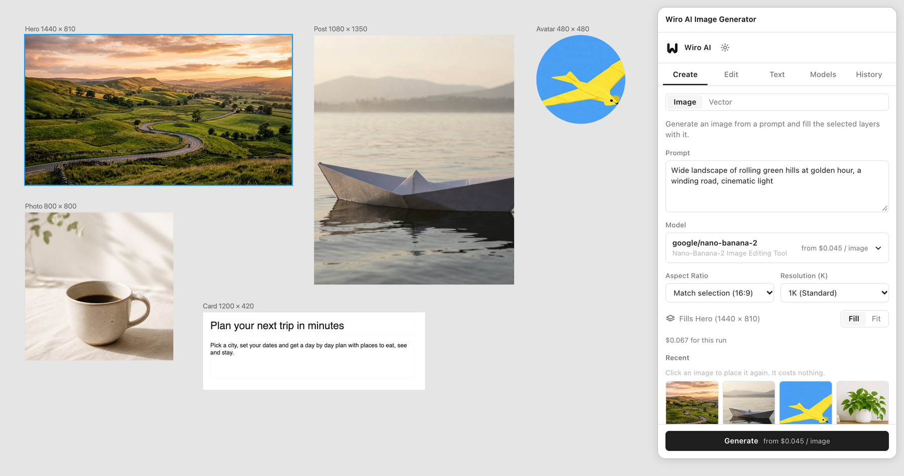
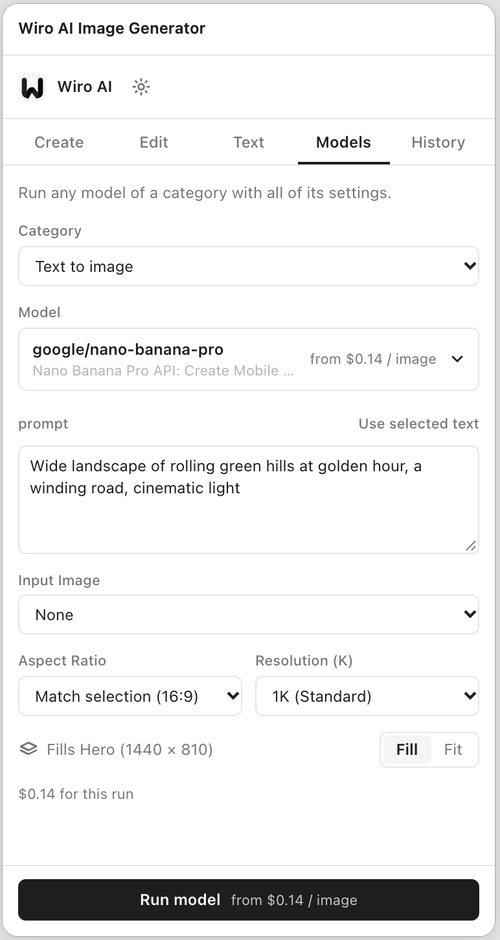
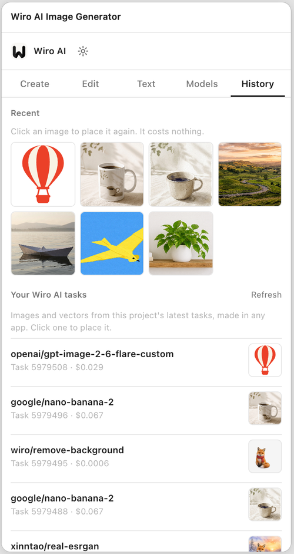
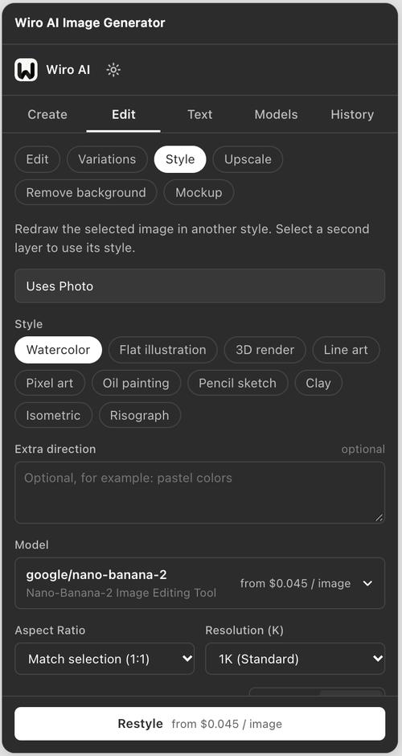
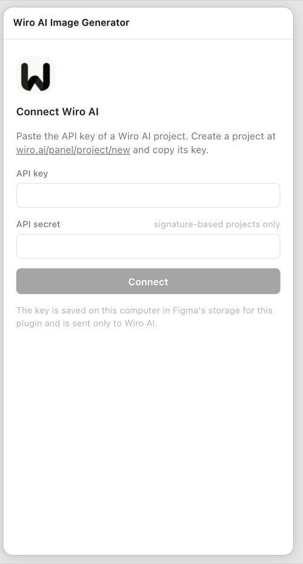
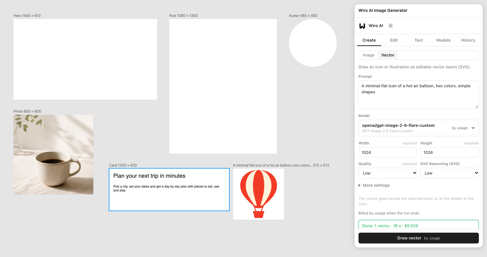
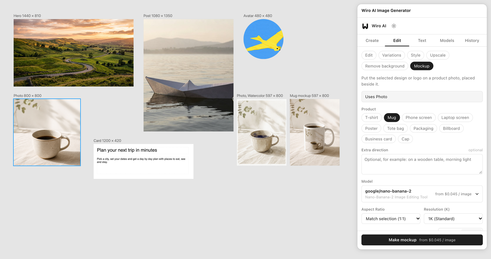
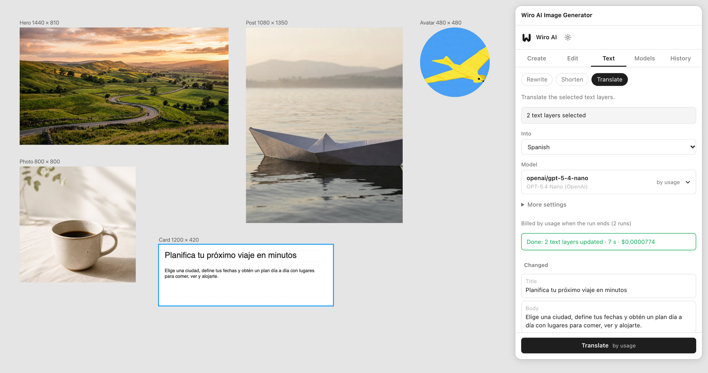

<div align="center">


# Wiro AI Image Generator for Figma

Generate images and vectors, edit and upscale pictures, remove backgrounds, make mockups and rewrite or translate text in Figma with Wiro AI models.

[](#install) [](https://github.com/wiroai/Wiro-Figma/actions/workflows/ci.yml) [](./LICENSE)

[Website](https://wiro.ai) · [Models](https://wiro.ai/models) · [Docs](https://wiro.ai/docs) · [Dashboard](https://wiro.ai/panel)


</div>

Select layers, pick what to do and choose a model. The plugin runs it on [Wiro AI](https://wiro.ai/docs/run-a-model) and puts the result back into your file: images as fills or as new layers beside the source, vectors as editable layers and text straight into your text layers. Each model shows its own settings and its price before you run it, and the Models tab runs any model of a category with a form built from its schema.



| Run any model                                                                                    | History                                                                                      | Light and dark                                                       | Connect with a key                                                                     |
| ------------------------------------------------------------------------------------------------ | -------------------------------------------------------------------------------------------- | -------------------------------------------------------------------- | -------------------------------------------------------------------------------------- |
|  |  |  |  |

## What it does

The panel has five tabs: **Create**, **Edit**, **Text**, **Models** and **History**.

### Create

- **Image.** Write a prompt and pick a model. The image fills the selected frames, shapes, text layers, components or instances. With nothing selected, it lands in a new rectangle in the middle of your view.
- **Matches the shape.** The **Match selection** ratio picks the model's ratio closest to the selected layer, so a 1920 × 1080 frame gets 16:9 and a 1080 × 1350 post gets 4:5 or the nearest ratio the model offers. Models that take an exact size, such as FLUX.2 Pro, get a width and height with the layer's shape.
- **Fills many layers at once.** With several layers selected, one run fills them in order: layer one gets image one, layer two gets image two. Turn on **One image per layer** and each layer gets its own run in its own shape, three at a time.
- **Vector.** Describe an icon or illustration and it comes back as SVG, added as editable vector layers beside the selected layer or in the middle of your view. It uses GPT Image 2.6 Flare Custom or GPT Image 2.6 Sunburst Custom with SVG output.

The image model list starts with popular models (Nano Banana Pro, Nano Banana 2, GPT Image 2, Seedream 4.5, FLUX.2 Pro, Reve Create, Grok Imagine, Qwen Image 3.0 Pro and P-Image), followed by the rest of the text-to-image models in the [Wiro AI catalog](https://wiro.ai/models). Search finds any of them by name.



### Edit

Select a layer and pick an action. A layer with an image fill sends its original image; any other layer, such as a frame with a design in it, is sent as a PNG of what it shows.

| Action                | What it does                                                                                                                                                                                   |
| --------------------- | ---------------------------------------------------------------------------------------------------------------------------------------------------------------------------------------------- |
| **Edit**              | Changes the image with a prompt, for example "put the bottle on a wet black stone, keep the label as it is".                                                                                   |
| **Variations**        | Makes 1 to 4 new versions of the image.                                                                                                                                                        |
| **Style**             | Redraws the image as watercolor, flat illustration, 3D render, line art, pixel art, oil painting, pencil sketch, clay, isometric or risograph. Select a second layer to use its style instead. |
| **Upscale**           | Makes the image larger and sharper, with Real-ESRGAN by default.                                                                                                                               |
| **Remove background** | Cuts out the subject on a transparent background, with BRIA RMBG 2.0 by default.                                                                                                               |
| **Mockup**            | Puts a design or logo on a product photo: t-shirt, mug, phone screen, laptop screen, poster, tote bag, packaging, billboard, business card or cap.                                             |

Each result either replaces the image in the layer or goes beside it as a new layer named after the source, such as "Photo, Watercolor" or "Mug mockup". Edit, Upscale and Remove background replace by default; Variations, Style and Mockup go beside. The prompt-based actions start on Nano Banana 2 and list the other image editing models in the catalog.



### Text

Select text layers, or frames that contain them, and pick an action. Each layer gets its own run, and the new text goes into the layer.

- **Rewrite** in a tone: clearer, friendlier, more formal, more persuasive, simpler, or grammar fixes only. You can add your own instruction.
- **Shorten** a bit, to half the length, to one line or to a few words.
- **Translate** into 29 languages, including Spanish, French, German, Japanese, Chinese, Arabic and Turkish.

The panel lists what changed, and Undo in Figma brings the old text back. A layer whose font is not installed is left as it was and named in the result. Text actions start on GPT-5.4 Nano and can use any chat model in the catalog.



### Models

Run any model of a category with all of its settings. Pick a category (text to image, edit with a prompt, image to image, upscale, remove background, restore photos, describe images, read text in images, translate or chat models), then a model, and the panel builds the form from the model's schema. Image inputs take a selected layer or a link, and **Use selected text** fills the prompt from your text layers. Images and vectors go on the canvas, text answers can be copied or added as a text layer, and other files, such as video or audio, open as links.

### History

**Recent** keeps your last 24 results. Click one to place it again in the current selection, without a new run. **Your Wiro AI tasks** lists images and vectors from the project's latest tasks, made in any app, and places them the same way.

### Everywhere

- **Shows the price first.** Every action shows its price in one line before it runs, and what the task cost after. See [Pricing](#pricing).
- **Picks up where it left off.** If you close the plugin while runs are going, their results are waiting the next time you open it (within a day).
- **Fits Figma's image rules.** WebP and other formats are turned into PNG, and images larger than 4096 px on a side are scaled down to fit, so 4K outputs still go in.
- **Follows your theme.** The panel uses Figma's light or dark colors.

## Install

1. Install the [Figma desktop app](https://www.figma.com/downloads/) and [Node.js](https://nodejs.org) 22 or later.
2. Clone this repository and build the plugin:

   ```bash
   git clone https://github.com/wiroai/Wiro-Figma.git
   cd Wiro-Figma
   npm ci
   npm run build
   ```

3. In the Figma desktop app, open a design file and use the main menu: **Plugins → Development → Import plugin from manifest…**, then pick `manifest.json` from the cloned folder.
4. Run it from **Plugins → Development → Wiro AI Image Generator**.

## Get an API key

Create a project at [wiro.ai/panel/project/new](https://wiro.ai/panel/project/new) and copy its API key. Paste it into the plugin's Connect screen. If the project uses signature-based authentication, paste its API secret too; projects set to API Key Only need just the key. Your projects and keys are listed at [wiro.ai/panel/project](https://wiro.ai/panel/project).

The key is checked with a free call before it is saved. To change or remove it later, open the gear icon in the plugin.

## Use it

1. Select the layers you want to work with, or nothing for a new layer.
2. Pick a tab, an action and a model.
3. Write a prompt where the action asks for one. **Cmd+Enter** (or **Ctrl+Enter**) starts the run.
4. Adjust the model's settings if you like; changes are remembered per model. **Fill** crops an image to cover the layer, **Fit** shows all of it.
5. Click the run button. **Cancel** stops the task on Wiro AI too.

## How it works

- The plugin talks to the hosted Wiro AI MCP endpoint at `https://mcp.wiro.ai/v1` with the project key as a Bearer token. A run is one `run_model` call that returns at once with a task token, followed by `wait_for_task` until the task ends. A failed wait is tried again; the run itself is never sent twice. Model lists come from `search_models`, forms and price tables from `get_model_schema`, the key check from `get_account` and History from `list_tasks`. Cancel uses `kill_task`.
- Selected images go to the model inside the request as data URIs, PNG or JPEG of at most 2048 px on the longer side. Text actions run the catalog's chat models as Wiro AI tasks through the same endpoint, with the layer's text in the prompt.
- Results are downloaded from `https://cdn1.wiro.ai` in the plugin's window. Images are turned into PNG or JPEG of at most 4096 px when needed and created with `figma.createImage`, SVGs become layers with `figma.createNodeFromSvg`, and text goes in after `figma.loadFontAsync`.
- Network access in [`manifest.json`](manifest.json) is limited to those two hosts. The plugin loads no remote code; its interface is built into `dist/ui.html`.
- It uses `documentAccess: "dynamic-page"` and the async node APIs, and is linted with Figma's [`@figma/eslint-plugin-figma-plugins`](https://github.com/figma/eslint-plugin-figma-plugins) rules. Undo in Figma takes back what the plugin changed.
- Each layer the plugin adds or fills keeps a small note in its plugin data: the model, the image URL and the task ID.

## Privacy

The plugin stores four things in Figma's `clientStorage` on your computer: the API key (and secret), your model choices and settings, the list of recent results and the tokens of runs that are still going. It sends Wiro AI what a run needs: your prompt and settings, the selected image for Edit actions and image inputs, and the text of the selected text layers for Text actions. It reads nothing else from your file than the selected layers. Nothing is sent to anyone else. See the Wiro AI [privacy policy](https://wiro.ai/agreement/privacy-policy) and [terms of service](https://wiro.ai/agreement/terms-of-service).

## Pricing

Each run is billed to your Wiro AI account at the model's price. The panel shows the price in one line before you run: the exact amount when the model's price table covers your settings (for example $0.067 for one 1K image from Nano Banana 2), multiplied by the images and runs, or the catalog price otherwise. Chat models are billed by usage, which comes to a fraction of a cent for a text layer. After each run the panel shows what it cost. Placing a recent image or a task from History again is free. Add funds at [wiro.ai/panel/billing](https://wiro.ai/panel/billing).

## Development

```bash
npm ci
npm run watch      # rebuilds dist/ on every change; reload the plugin in Figma
npm test           # unit tests
npm run all        # formatting, lint, type check, tests, build and the plugin check
```

| Path                       | What it is                                                                              |
| -------------------------- | --------------------------------------------------------------------------------------- |
| `src/code.ts`, `src/main/` | The main thread: selection, placement, image export, text layers and client storage     |
| `src/ui/`                  | The panel (Preact): actions, forms built from model schemas, prices, the Wiro AI client |
| `src/shared/`              | Message types and geometry used by both sides                                           |
| `scripts/build.mjs`        | Builds `dist/code.js` and a self-contained `dist/ui.html` with esbuild                  |
| `scripts/check-plugin.mjs` | Checks the manifest and the build: required fields, network access, inline UI           |
| `test/`                    | Unit tests, live tests and a browser harness                                            |

`npm run harness` builds the plugin and serves a test page at `http://127.0.0.1:5178`. It runs `dist/code.js` against a stand-in for the Figma plugin API and shows `dist/ui.html` in a sandboxed iframe with the same network rules as the manifest. With `WIRO_API_KEY` set, the panel starts connected.

`npm run test:live` runs the model list, two image runs, a background removal and a text rewrite against the live API when `WIRO_API_KEY` is set (and `WIRO_API_SECRET` for signature-based projects). A full run costs a few cents.

## More from Wiro AI

| Repository                                                                   | What it is                                                                                                                                     |
| ---------------------------------------------------------------------------- | ---------------------------------------------------------------------------------------------------------------------------------------------- |
| [Wiro-MCP](https://github.com/wiroai/Wiro-MCP)                               | Official MCP server for Wiro AI, [`@wiro-ai/wiro-mcp` on npm](https://www.npmjs.com/package/@wiro-ai/wiro-mcp)                                 |
| [Wiro-Plugin](https://github.com/wiroai/Wiro-Plugin)                         | Wiro AI plugin for Cursor, Claude Code, Gemini CLI and Devin                                                                                   |
| [Wiro-LLM](https://github.com/wiroai/Wiro-LLM)                               | Wiro AI provider for the Vercel AI SDK and LLM gateway examples, [`@wiro-ai/wiro-llm` on npm](https://www.npmjs.com/package/@wiro-ai/wiro-llm) |
| [Wiro-Chromium-Extension](https://github.com/wiroai/Wiro-Chromium-Extension) | Wiro AI extension for Chrome, Edge, Opera and Brave                                                                                            |
| [Wiro-Firefox-Extension](https://github.com/wiroai/Wiro-Firefox-Extension)   | Wiro AI add-on for Firefox                                                                                                                     |
| [Wiro-Safari-Extension](https://github.com/wiroai/Wiro-Safari-Extension)     | Wiro AI extension for Safari on the Mac                                                                                                        |
| [Swift-QuickStart](https://github.com/wiroai/Swift-QuickStart)               | WiroKit, the Wiro AI SDK for iOS                                                                                                               |
| [Kotlin-QuickStart](https://github.com/wiroai/Kotlin-QuickStart)             | WiroKit, the Wiro AI SDK for Android                                                                                                           |
| [Dart-QuickStart](https://github.com/wiroai/Dart-QuickStart)                 | Wiro AI SDK for Dart and Flutter, [`wiro` on pub.dev](https://pub.dev/packages/wiro)                                                           |
| [ReactNative-QuickStart](https://github.com/wiroai/ReactNative-QuickStart)   | Wiro AI SDK for React Native and Expo, [`@wiro-ai/wiro-react-native` on npm](https://www.npmjs.com/package/@wiro-ai/wiro-react-native)         |
| [Swift-Realtime](https://github.com/wiroai/Swift-Realtime)                   | Realtime voice AI example for iOS                                                                                                              |
| [Kotlin-Realtime](https://github.com/wiroai/Kotlin-Realtime)                 | Realtime voice AI example for Android                                                                                                          |
| [Dart-Realtime](https://github.com/wiroai/Dart-Realtime)                     | Realtime voice AI example for Flutter                                                                                                          |
| [ReactNative-Realtime](https://github.com/wiroai/ReactNative-Realtime)       | Realtime voice AI example for React Native                                                                                                     |
| [n8n-nodes-wiroai](https://github.com/wiroai/n8n-nodes-wiroai)               | Wiro AI nodes for n8n, [`@wiro-ai/n8n-nodes-wiroai` on npm](https://www.npmjs.com/package/@wiro-ai/n8n-nodes-wiroai)                           |
| [Wiro-Dify-Plugin](https://github.com/wiroai/Wiro-Dify-Plugin)               | Wiro AI plugins for Dify: the LLM gateway as a model provider, plus image, video, speech and music tools                                       |
| [Wiro-ComfyUI](https://github.com/wiroai/Wiro-ComfyUI)                       | Wiro AI nodes for ComfyUI                                                                                                                      |
| [Wiro-Hermes](https://github.com/wiroai/Wiro-Hermes)                         | Wiro AI model provider plugin for Hermes Agent                                                                                                 |
| [Wiro-Zed](https://github.com/wiroai/Wiro-Zed)                               | Wiro AI MCP server extension for Zed                                                                                                           |
| [Wiro-Action](https://github.com/wiroai/Wiro-Action)                         | GitHub Action for Wiro AI models and the LLM gateway, [on the GitHub Marketplace](https://github.com/marketplace/actions/wiro-ai-action)       |
| [Wiro-Figma](https://github.com/wiroai/Wiro-Figma)                           | Wiro AI plugin for Figma: images, vectors, image edits and text                                                                                |
| [Wiro-Docs](https://github.com/wiroai/Wiro-Docs)                             | Source of the Wiro AI API docs                                                                                                                 |

[Website](https://wiro.ai) · [Models](https://wiro.ai/models) · [Docs](https://wiro.ai/docs) · [X](https://x.com/wiroai)

## License

MIT, see [LICENSE](./LICENSE).
